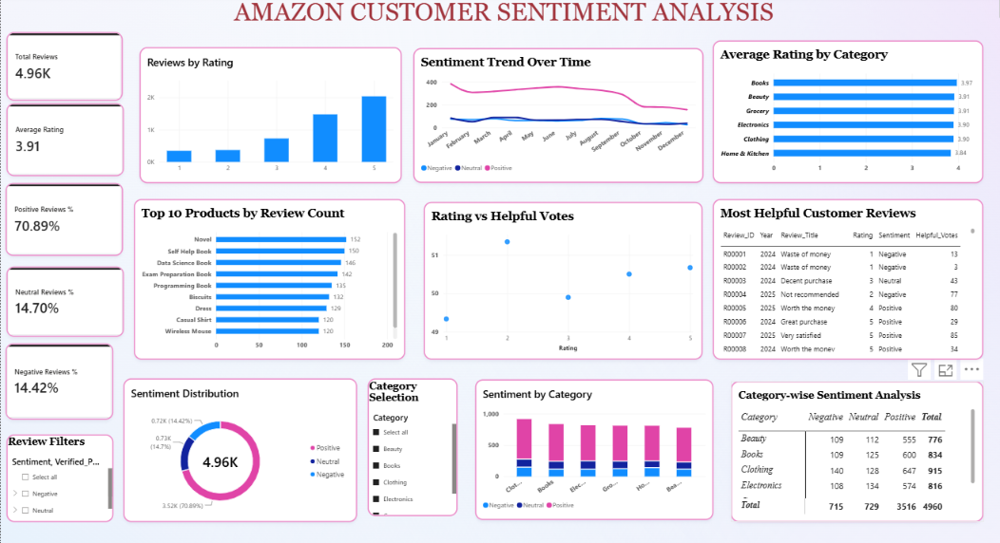

# Amazon Customer Sentiment Analysis
Amazon Customer Sentiment Analysis using Power BI.

## About the Project
This project analyzes customer reviews to understand customer sentiment, ratings, and product feedback using an interactive Power BI dashboard.

## Key Features
* Customer sentiment analysis
* Average customer rating
* Sentiment trends over time
* Category-wise sentiment analysis
* Top 10 products by review count
* Helpful customer review analysis

## Tools Used
* Microsoft Power BI
* DAX
* Data Cleaning
* Data Visualization

## Key Insights
* **Total Reviews:** 4,960
* **Average Rating:** 3.91/5
* **Positive Reviews:** 70.89%
* **Neutral Reviews:** 14.70%
* **Negative Reviews:** 14.42%

## Dashboard Preview

## Project Objective
To transform customer review data into meaningful insights through data analysis and visualization.

To transform customer review data into meaningful insights through data analysis and visualization.

